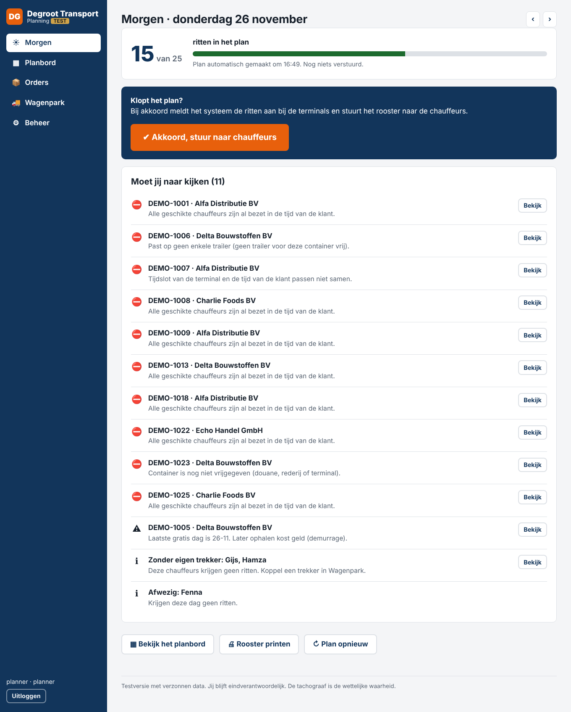
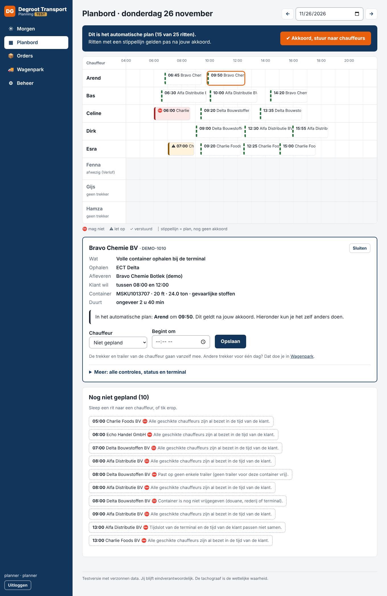
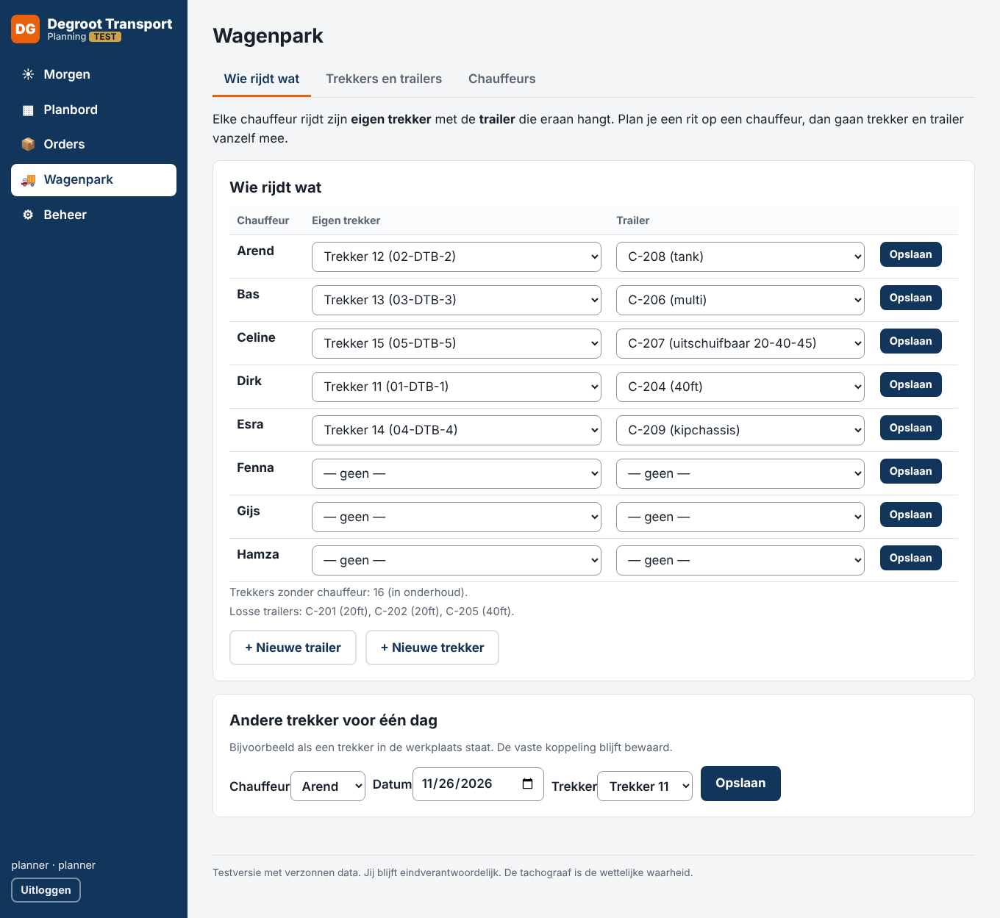

# Planning Degroot Transport (testversie)

Een **testversie** van een planningssysteem voor containertransport rond Rotterdam, in de stijl van Degroot Transport.
**Het plan maakt zichzelf. Jij geeft één keer akkoord.**

> ⚠ **Belangrijk**
> - Dit is een testversie met **verzonnen data**. De chauffeurs, klanten en kentekens bestaan niet.
>   Alleen de bedrijfsnaam is echt (instelbaar via `BEDRIJFSNAAM` in `.env`).
> - De **planner is eindverantwoordelijk**. Het systeem belooft geen perfectie en geen wettelijke naleving.
> - De **tachograaf is de wettelijke waarheid**. Het systeem voorspelt alleen.
> - Veel regels, tarieven en gewichten zijn een **aanname, schatting of open vraag**.
>   Controleer ze altijd bij de bron voordat je er iets mee doet.

## Zo werkt het (elke dag)

1. **Open de app.** Je komt op **Morgen**. Het systeem maakt vanzelf een plan voor morgen (duurt een paar seconden).
2. **Kijk naar "Moet jij naar kijken".** Daar staan alleen de ritten die niet lukken, met één korte reden.
3. **Druk op "Akkoord, stuur naar chauffeurs".** Het systeem meldt de ritten aan bij de terminal (simulator)
   en stuurt het rooster naar de chauffeurs. Ritten met een probleem worden **niet** verstuurd.
4. **Wil je iets anders?** Ga naar het **Planbord**. Daar staat één rij per chauffeur.
   Tik op een rit of sleep hem naar een andere chauffeur. De trekker en trailer van die chauffeur gaan vanzelf mee.

Het menu heeft maar vijf knoppen: **Morgen, Planbord, Orders, Wagenpark, Beheer**.
Alle details (regels, logboek, instellingen, eerdere plannen, facturen) staan onder **Beheer**,
of op het planbord onder **"Meer"** bij een rit.

| Morgen | Planbord | Wagenpark |
|---|---|---|
|  |  |  |

### Plannen op de chauffeur

- Elke chauffeur heeft een **eigen trekker**. Aan elke trekker hangt een **trailer**.
  Dat koppel je in **Wagenpark → Wie rijdt wat**. Nieuwe trailers voeg je daar ook toe.
- Staat een trekker in de werkplaats? Geef de chauffeur dan in Wagenpark een **andere trekker voor één dag**.
  De vaste koppeling blijft bewaard.
- Een chauffeur zonder trekker of trailer krijgt geen ritten. Dat zie je op het startscherm.

## Demo-scenario (10 minuten)

1. Start de app en log in als `planner`. Je ziet **Morgen**: het plan wordt gemaakt.
2. Na een paar seconden: ongeveer **15 van de 25 ritten** in het plan. Kijk in de lijst waarom de rest niet lukt.
   Je ziet de valkuilen uit de demodata terug, bijvoorbeeld:
   - een container die nog niet is vrijgegeven,
   - een container die op geen enkele trailer past,
   - een chauffeur met verlof (Fenna) en chauffeurs zonder trekker (Gijs, Hamza).
3. Open het **Planbord**. De ritten met een stippellijn zijn het plan, nog zonder akkoord.
   Tik op een rit: je ziet ophalen, afleveren, tijd van de klant en eventuele problemen in gewone woorden.
4. Ga naar **Wagenpark** en koppel trekker 16 met trailer C-205 aan Gijs. (Let op: trekker 16 staat in onderhoud,
   dus het plan zal hem toch niet gebruiken. Probeer daarna eens "Andere trekker voor één dag".)
5. Terug naar **Morgen**, druk op **Plan opnieuw** en daarna op **Akkoord**. Kijk hoeveel ritten zijn verstuurd.
6. Log in als `chauffeur` (ander venster) en bekijk **Mijn ritten**.
7. Log in als `admin`, ga naar **Beheer → Instellingen** en zet de **noodstop** aan. Automatisch plannen stopt.

## Wat is nog niet echt

- **Portbase** (aanmelden bij de terminal) is een **simulator**. Er gaat niets naar buiten.
- **Reistijden** zijn een schatting (afstand en vaste snelheid), geen echte route of file-informatie.
- **Order inlezen** uit e-mail is een eenvoudige tekst-herkenner, geen AI. Jij controleert altijd.
- **Berichten naar chauffeurs** gaan alleen naar de chauffeurspagina in de app (geen app of sms).
- **Tarieven, demurrage en facturen** zijn voorbeeldwaarden. BTW wordt niet berekend.
- **Geen GPS** en geen koppeling met de tachograaf.
- Inloggen is simpel (geen tweestapsverificatie).

## Wat moet je zelf controleren

- **Gewichten en aslasten**: leeggewichten van trekkers en trailers zijn deels een aanname (zie Wagenpark).
- **Rijtijden en pauzes**: het systeem rekent met EU-regels (9 uur per dag, pauze na 4,5 uur), maar de
  tachograaf beslist. Kijk zelf naar uitzonderingen (10-urige dagen, gesplitste rust).
- **Regels met status "schatting" of "open"** in Beheer → Stamdata en regels. Zoek de bron op.
- **Laatste gratis dag en vrijgave** van containers: altijd nakijken bij rederij en terminal.
- **ADR, pasjes (ECT, Cargocard) en rijverboden in Duitsland**: geldigheid en datums kloppen alleen als
  ze goed zijn ingevuld.
- Alles wat in de app een **"aanname"**-label heeft. De lijst staat in `docs/AANNAMES.md`.

## Starten (één commando)

Je hebt **Python 3.11 of nieuwer** nodig ([python.org/downloads](https://www.python.org/downloads/)).
Op Windows: vink bij installeren "Add python.exe to PATH" aan.

| Systeem | Commando |
|---|---|
| Windows | dubbelklik op `start.bat` (of typ `start.bat` in de map) |
| Mac / Linux | `./start.sh` |

Het script doet alles zelf:
1. maakt een virtuele omgeving (`.venv`, een aparte map met de pakketten voor deze app),
2. installeert de pakketten (de eerste keer heb je internet nodig, daarna niet meer),
3. maakt een `.env`-bestand met een geheime sleutel,
4. zet de database klaar (migraties) en vult de demodata,
5. start de app.

Open daarna **http://localhost:8000** in je browser.

Verse demodata nodig (bijvoorbeeld een dag later)? Start met `./start.sh --reset` of `start.bat --reset`.
De demo-orders staan altijd op **morgen**, gerekend vanaf het moment dat je de demodata laadt.

### Inloggen (alleen op je eigen computer)

| Gebruiker | Rol | Wat mag het |
|---|---|---|
| `planner` | planner | plannen, stamdata en regels aanpassen |
| `admin` | admin | alles, plus instellingen en noodstop |
| `chauffeur` | chauffeur | alleen de chauffeurspagina |

Het wachtwoord staat in `.env` bij `DEMO_WACHTWOORD` (standaard `demo1234`).
**Draait de app ooit buiten je eigen computer? Verander dan eerst alle wachtwoorden en de geheime sleutel.**

## Tests draaien

```bash
source .venv/bin/activate        # Windows: .venv\Scripts\activate
pytest                           # alle tests
pytest tests/test_iso6346.py -v  # één testbestand, met namen
ruff check app tests             # controle van de codestijl
```

Laatste run van de belangrijkste tests (gewicht, rijtijd, solver):

```text
$ pytest tests/test_gewicht.py tests/test_rijtijd.py tests/test_solver.py
37 passed in 19.70s
```

Alle tests samen: **147 passed** (ruff: geen fouten).

## Hoe zit het in elkaar?

| Map | Wat staat erin |
|---|---|
| `app/models.py` | alle tabellen van de database |
| `app/audit.py` | het logboek: elke wijziging wordt vanzelf vastgelegd |
| `app/rules/` | de regelmotor: alle controles op één plek |
| `app/ports/` | "poorten" naar de buitenwereld (klok, reistijden, Portbase, orderlezer) met nep-versies |
| `app/web/` | de pagina's |
| `app/seed.py` | de demodata (alles verzonnen) |
| `migrations/` | database-migraties (Alembic) |
| `docs/` | onderzoek, aannames, noodprocedure |
| `tests/` | de tests |

Belangrijke keuzes:
- **Regels zijn data.** Limieten, tarieven, slotregels en feestdagen staan in de database, met
  `geldig_van`, `geldig_tot`, `bron` en `status` (bevestigd / schatting / open). Aanpassen kan via
  *Stamdata en regels*. Elke wijziging staat in het logboek.
- **Logboek.** Wie, wat, voor, na en wanneer. Via de app kun je het niet wijzigen of wissen.
- **Niets echt verwijderen.** Je kunt archiveren. De geschiedenis blijft bewaard.
- **Gewicht in hele kg, geld in hele centen.** Tijden staan in UTC en worden in Nederlandse tijd getoond.
- **Geen taalmodel.** Alle berekeningen en uitleg maakt gewone, geteste code.

## Nog te doen (later)

- Tweestapsverificatie (2FA) bij het inloggen.
- Zie verder het plan per mijlpaal.

## Status per mijlpaal

- [x] Mijlpaal 1: basis (login, logboek, regels als data, demodata, stamdata-schermen, start-scripts)
- [x] Mijlpaal 2: voertuigen en regelmotor (trekker, chassis, voorkeuren, combinatiepagina, sjablonen, CSV, gewicht, aslast, chassis-fit, ADR, reefer, hoogte, verbodsdag)
- [x] Mijlpaal 3: planbord (dag per trekker of chauffeur, slepen, toewijzen, alle regels per rit met uitleg, slots, LFD-kosten, rijtijd, override met reden, publiceren)
- [x] Mijlpaal 4: voorstellen (OR-Tools CP-SAT, alleen toegestane combinaties, exacte controle achteraf, uitleg uit code, vergelijking met het plan, herbereken met vastheid, job-wachtrij)
- [x] Mijlpaal 5: Portbase-simulator, order inlezen, chauffeurspagina, factuurconcept, noodstop, export, back-up, noodprocedure, aannames
- [x] Nieuw ontwerp: startscherm Morgen (plan maakt zichzelf, één keer akkoord), rustig planbord per chauffeur, plannen op de chauffeur, Wagenpark koppelen, gewone woorden
